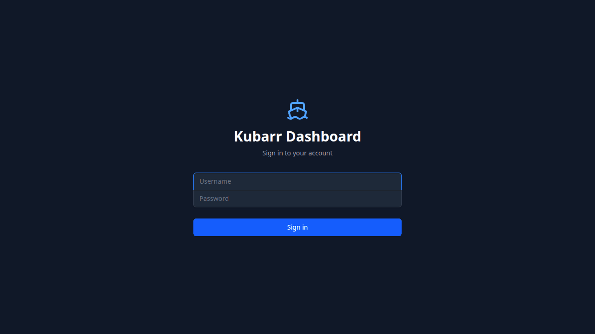

# Kubarr

<p align="center">
  
</p>

[](https://opensource.org/licenses/MIT)
[](https://kubernetes.io/)
[](https://github.com/smokeythebandit/Kubarr/releases)

> A Kubernetes-native dashboard for managing media server applications with security isolation, easy deployment, and comprehensive monitoring.

## Overview

Kubarr is built specifically for managing media server infrastructure on Kubernetes. Deploy and manage your entire media stack—Plex, Sonarr, Radarr, qBittorrent, and more—through a unified dashboard with proper security isolation between applications.

**Core Design Principles:**
- **Security by Separation** - Each application runs in its own namespace with isolated resources and network policies
- **Easy Installation & Updates** - One-click deployment from a curated application catalog with automatic updates
- **Comprehensive Monitoring** - Real-time resource usage, health checks, and application metrics
- **Clean Interface** - Manage everything from a single dashboard without memorizing kubectl commands

## Features

### Application Management

**Media Server Catalog** - Pre-configured templates for popular media applications:
- **Media Servers**: Plex, Jellyfin, Emby
- **Media Management**: Sonarr, Radarr, Lidarr, Readarr
- **Indexers**: Prowlarr, Jackett, NZBHydra2
- **Download Clients**: qBittorrent, SABnzbd, Transmission, Deluge
- **Request Management**: Overseerr, Ombi
- **Subtitle Management**: Bazarr

**One-Click Deployment** - Deploy applications with sensible defaults. Each application automatically gets its own namespace with proper resource limits and network policies.

**Easy Updates** - Update applications to newer versions without manual configuration changes. Helm chart integration handles upgrades cleanly.

### Security & Isolation

**Namespace Separation** - Each application runs in its own Kubernetes namespace, providing resource and network isolation. Applications cannot interfere with each other.

**Authentication & RBAC** - JWT-based authentication with role-based access control. Support for multiple users with different permission levels.

**Network Policies** - Control which applications can communicate with each other. Restrict external access where needed.

**Secret Management** - Encrypted storage for API keys, passwords, and credentials. Edit secrets through the UI without exposing values in logs.

### Monitoring & Troubleshooting

**Real-Time Metrics** - Track CPU, memory, network, and disk usage per application. See resource utilization trends over time.

**Health Checks** - Automatic monitoring of pod health and readiness. Get notified when applications become unhealthy.

**Log Streaming** - View live logs from any application. Filter by container, search for specific messages, and download logs for offline analysis.

**Resource Alerts** - Configure alerts for high resource usage, pod restarts, or application failures.

### Configuration

**Environment Variables** - Edit application settings through a simple interface. Changes restart pods automatically.

**Storage Management** - Visualize persistent volumes and their usage. Attach additional storage to applications as needed.

**Port Management** - Configure service ports and ingress rules. Set up external access with proper security controls.


## Quick Start

### Install with the Browser Wizard

On Linux x86_64 or ARM64:

```bash
curl -fsSL https://kubarr.com/install.sh | bash
```

Open the printed invitation URL. Select an existing Kubernetes context, upload a kubeconfig, or create a local k3s cluster, then configure storage, dashboard access, and the initial administrator. Keep the terminal open until installation finishes and use the dashboard access instructions shown by the wizard.

The CLI installs separate platform charts; there is no umbrella `kubarr` chart. See the [Quick Start](./docs/quick-start.md).

### Local Development

```bash
# Clone the repository
git clone https://github.com/smokeythebandit/Kubarr.git
cd Kubarr

# Build and run the API (requires a configured database)
cd code/api
cargo run --locked --bin kubarr-api

# In another shell, build and run the frontend
cd code/frontend
pnpm install
pnpm dev

# Access the frontend at the Vite dev server URL
```

Use Rust 1.94+, Node.js 26, and pnpm 10.34.3+. See the [Development Guide](./docs/development.md) for database, worker, and frontend proxy setup.

The installer is maintained in [kubarr-cli](https://github.com/smokeythebandit/kubarr-cli), with independent versions and releases. See its [Bootstrap Guide](https://github.com/smokeythebandit/kubarr-cli/blob/main/docs/bootstrap.md) for browser setup and CLI development.

## Architecture

Kubarr consists of these main components:

- **Gateway** (OpenResty) - Dashboard routing and authenticated application proxying
- **API** (Rust/Axum) - Authentication, configuration, monitoring, and operation enqueueing
- **Worker** (Rust) - Queued Helm operations and Kubernetes reconciliation
- **Frontend** (React/TypeScript) - SPA with real-time updates via WebSockets
- **Database** (PostgreSQL) - Application state and configuration storage

```
Browser → OpenResty gateway → React frontend / Rust API
                                              ↓
                                         PostgreSQL
                                              ↑
                                         Rust worker → Helm / Kubernetes
```

**Technology Stack:**
- Backend: Rust, Axum, SeaORM, kube-rs
- Frontend: React, TypeScript, Tailwind CSS
- Database: PostgreSQL (production), SQLite (development)
- Deployment: Docker, Kubernetes, Helm

The API and worker share the library in `code/api`; the worker entrypoint is in `code/worker`. Gateway configuration lives in [kubarr-charts](https://github.com/smokeythebandit/kubarr-charts/tree/main/system/openresty). `code/dns-webhook` contains the Go cert-manager TransIP solver. See [Architecture](./docs/architecture.md) for request flows.

## Documentation

- [Quick Start Guide](./docs/quick-start.md) - Get running in 15 minutes
- [Bootstrap Guide](https://github.com/smokeythebandit/kubarr-cli/blob/main/docs/bootstrap.md) - First-time setup with the CLI
- [Configuration Reference](./docs/configuration.md) - Environment variables and Helm values
- [User Guide](./docs/user-guide.md) - How to use Kubarr effectively
- [Architecture](./docs/architecture.md) - System design and decisions
- [API Documentation](./docs/api.md) - REST API reference
- [Development Guide](./docs/development.md) - Contributing to Kubarr
- [Versioning System](./docs/versioning.md) - Version management and releases

## Contributing

Contributions are welcome! Please see [Development Guide](./docs/development.md) for setup instructions.

- Issues: [GitHub Issues](https://github.com/smokeythebandit/Kubarr/issues)
- Discussions: [GitHub Discussions](https://github.com/smokeythebandit/Kubarr/discussions)

## License

This project is licensed under the MIT License - see the [LICENSE](./LICENSE) file for details.
